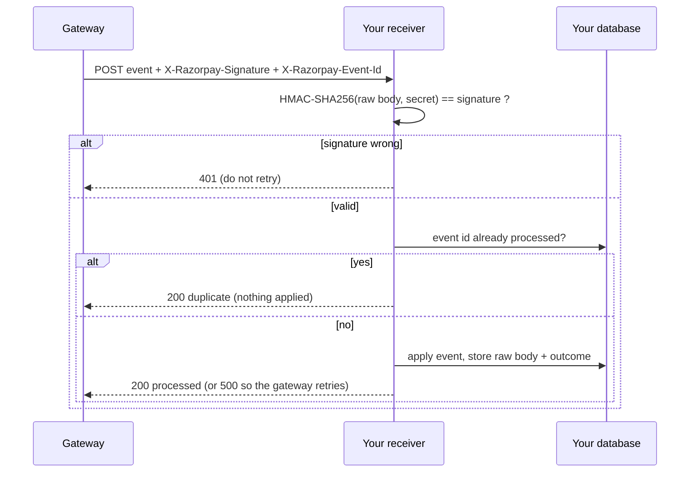

# Webhook integration guide

How to receive payment events from a gateway safely, using SettleGuard's receiver as the worked example.
The signature scheme and header names follow what Razorpay documents for its webhooks (HMAC-SHA256 of the raw body in
`X-Razorpay-Signature`, a unique id in `X-Razorpay-Event-Id`). SettleGuard is a sandbox and is not affiliated with Razorpay:
check the gateway's current documentation before wiring up a real account.

## The flow



## 1. Configure

| Setting | Where | Notes |
|---|---|---|
| `WEBHOOK_SECRET` | server environment | Must equal the secret you set for the webhook in the gateway dashboard. If unset the receiver answers `503` instead of accepting unsigned data. |
| `WEBHOOK_ADMIN_TOKEN` | server environment (optional) | When set, the delivery log, payment lookup and replay endpoints require header `X-Admin-Token`. Always set it on a public deployment. |
| Endpoint URL | gateway dashboard | `https://<your-host>/api/webhooks/payments` |

## 2. What the receiver does with each delivery

| Case | Response | Gateway behaviour |
|---|---|---|
| Valid, new event | `200` `{"status":"processed"}` | Stops retrying |
| Valid, event id already processed | `200` `{"duplicate":true}` | Stops retrying; nothing is applied twice |
| Valid, event type we do not handle | `200` `{"status":"ignored"}` | Stops retrying |
| Signature missing or wrong | `401` | Not worth retrying |
| No `X-Razorpay-Event-Id`, or body is not a JSON event | `400` | Not worth retrying |
| Body over 1 MB | `413` | |
| Could not apply (bad amount, unknown payment, amount mismatch, over-refund) | `500` `{"retry":true}` | Retries later; the raw body is kept so you can replay it |
| `WEBHOOK_SECRET` not configured | `503` | |

Events handled: `payment.authorized`, `payment.captured`, `payment.failed`, `refund.processed`.

State rules: a payment only moves forward (`created` < `authorized` < `failed` < `captured` < `partially_refunded` < `refunded`),
so a late `payment.authorized` after `payment.captured` is acknowledged and ignored. Amounts are integers in paise and must match
the stored payment.

## 3. Try it

Send a signed event with the helper (prints the response; `--show-curl` prints the equivalent cURL):

```bash
export WEBHOOK_SECRET=whsec_demo
python app.py &                                             # server with the same secret in its environment
python scripts/send_webhook.py --event payment.authorized --event-id evt_1
python scripts/send_webhook.py --event payment.captured   --event-id evt_2 --repeat 2    # second send is a duplicate
python scripts/send_webhook.py --event payment.captured   --event-id evt_3 --tamper      # 401: body changed after signing
```

Or by hand with cURL and OpenSSL (the signature is over the exact bytes you send):

```bash
BODY='{"entity":"event","event":"payment.captured","created_at":1700000000,"payload":{"payment":{"entity":{"id":"pay_1","order_id":"order_1","amount":50000,"currency":"INR","method":"upi"}}}}'
SIG=$(printf '%s' "$BODY" | openssl dgst -sha256 -hmac "$WEBHOOK_SECRET" | awk '{print $2}')
curl -i -X POST http://localhost:5000/api/webhooks/payments \
  -H 'Content-Type: application/json' -H 'X-Razorpay-Event-Id: evt_manual_1' -H "X-Razorpay-Signature: $SIG" \
  --data-binary "$BODY"
```

Use `printf '%s'` and `--data-binary`: `echo` adds a newline and plain `-d` can alter the body, either of which breaks the signature.

A Postman collection with the success, duplicate, stale, bad-signature, missing-id and out-of-order cases is in
`docs/postman/SettleGuard.postman_collection.json` (import it, then set `baseUrl`, `webhook_secret`, `admin_token`).
Its pre-request script signs the raw body with the same HMAC.

## 4. Inspect and recover

```bash
curl -H "X-Admin-Token: $T" 'localhost:5000/api/webhooks/events?status=failed'     # delivery log
curl -H "X-Admin-Token: $T" localhost:5000/api/webhooks/events/evt_5               # one delivery, with the raw body
curl -H "X-Admin-Token: $T" localhost:5000/api/webhooks/payments/pay_1             # state built from events
curl -X POST -H "X-Admin-Token: $T" localhost:5000/api/webhooks/events/evt_5/replay # re-apply a failed event
```

## 5. Implementation notes for your own receiver

- Verify the signature on the **raw bytes** before parsing. Re-serialised JSON changes whitespace and key order.
- Compare signatures with a constant-time function (`hmac.compare_digest`).
- Make processing idempotent on the event id, in the same transaction as the state change. Gateways deliver at least once.
- Answer fast and do slow work afterwards. Return `2xx` only when the event is safely stored.
- Do not trust event order. Guard state transitions and keep the raw payload so you can replay.
- Never log the secret or full card/VPA details.

Next: [TROUBLESHOOTING.md](TROUBLESHOOTING.md).
